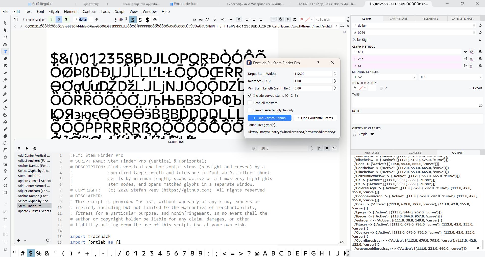

# Stem Finder Pro for FontLab 9
 

A Python 3.11 + PythonQt script for **FontLab 9** that locates vertical and horizontal stems (both straight and curved) matching a target width and tolerance, highlights the matching stem nodes, and opens all matched glyphs in a separate Glyph window for rapid quality assurance and optical consistency checks.

---

## Features

* **Vertical & Horizontal Stem Detection:** Scans glyph contours for opposing vertical or horizontal stem walls separated by your target width (`± tolerance`).
* **Curved Stem Support (`Include curved stems`):** Evaluates vertical and horizontal curve extrema (bowls, arches, and spines such as `O`, `C`, `S`, `e`, `oe`, `zecyr`) in addition to straight segments.
* **Serif & Bracket Filtering (`Min. Stem Length`):** Filters out short serif tips, brackets, or tiny notches by requiring a minimum segment length.
* **Single or Multi-Master Scanning (`Scan all masters`):** Inspects either the currently active master layer or every master in the font simultaneously, highlighting nodes across all matching layers.
* **Scoped Search:** Search across the entire font or limit the scan to glyphs currently selected in the Font Window.
* **Instant Highlighting & Inspection:**
  * Selects the exact boundary nodes/handles forming each matched stem inside the glyph layer.
  * Selects all matched glyphs in the Font Window and triggers a separate Glyph window/tab.
  * Copies the slash-separated glyph string (e.g. `/Ylongcyr/becyr/icyr/DZ/dz`) directly to the clipboard and displays it in the dialog.
  * Logs a detailed per-glyph, per-master coordinate breakdown in FontLab's **Output** panel.

---

## Requirements

* **FontLab 9** (with Python 3.11 and PythonQt enabled)
* macOS or Windows

---

## Installation

1. Download `StemFinderPro.py` from this repository.
2. Open FontLab 9 and go to **Help > Open User Data Folder** (or locate your FontLab 9 `Scripts` directory).
3. Copy `StemFinderPro.py` into the **`Scripts`** folder.
4. In FontLab 9, choose **Scripts > Update/Rescan Scripts**.
5. Launch the tool anytime from **Scripts > Stem Finder Pro**.

*(Alternatively, paste the contents of `StemFinderPro.py` into **Window > Panels > Scripting** and click **Run**.)*

---

## Usage

1. Open your font in **FontLab 9**.
2. Launch **Scripts > Stem Finder Pro**.
3. Configure your search parameters:
   * **Target Stem Width:** The stem thickness in font units you want to find (e.g. `22.0` or `85.0`).
   * **Tolerance (+/-):** Allowed deviation in font units (e.g. `1.0`).
   * **Min. Stem Length (serif filter):** Minimum length in font units for straight segments; increase this (e.g. `60`–`100`) to ignore thin serifs and short crossbars.
   * **Include curved stems (O, C, S):** Check to include opposing curve extrema alongside straight segments.
   * **Scan all masters:** Check to scan every master layer in the font at once.
   * **Search selected glyphs only:** Check to restrict the scan to glyphs selected in the Font Window.
4. Click **1. Find Vertical Stems** or **2. Find Horizontal Stems**.
5. Inspect the matched glyphs in the newly opened Glyph window—the detected stem nodes are already highlighted for editing, and full coordinates are printed in **Window > Panels > Output**.

---

## Output Example

```text
--- Vertical Stems: 22.0 +/- 1.0 ---
  /Ylongcyr -> {'Active': [(21.0, 120.0, 141.0, 'straight')]}
  /becyr -> {'Active': [(22.0, 49.0, 71.0, 'straight'), (22.0, 49.0, 71.0, 'curve')]}
  /gecyr.loclBGR -> {'Active': [(21.0, 396.0, 417.0, 'curve')]}
  /DZ -> {'Active': [(22.0, 88.0, 110.0, 'straight')]}
```

Each tuple reports `(measured_width, start_coordinate, end_coordinate, stem_type)`.

---

## Copyright & Disclaimer

**Copyright:** © 2026 Stefan Peev (https://github.com/StefanPeev). All rights reserved.

**Disclaimer:**
This script is provided "as is", without warranty of any kind, express or implied, including but not limited to the warranties of merchantability, fitness for a particular purpose, and noninfringement. In no event shall the author or copyright holder be liable for any claim, damages, or other liability arising from the use of this script. Use at your own risk.  
  
  
# Build Combining Diacritical Marks (FontLab 9)

A zero-dependency Python script for **FontLab 9** that automatically scans the active font for spacing diacritical marks, generates or updates their corresponding **Combining Diacritical Marks** (`U+0300`–`U+036F`), links each spacing mark as a live **Element Reference**, optically centers it along the master's **Italic Angle**, and sets the advance width to `0`.

## Features

- **Automatic Glyph Detection:** Matches spacing marks by standard Adobe/FontLab glyph names (`grave`, `acute`, `dieresis`, `cedilla`, `ogonek`, etc.) as well as fallback Unicode codepoints (`U+0060`, `U+00B4`, `U+02C6`, etc.).
- **Live Element References:** Places each spacing diacritic as a linked `GlyphComponent` (Element Reference) so any future outline edits propagate automatically.
- **Multi-Master Support:** Iterates through all font masters and updates each master layer independently.
- **Optical Italic Angle Centering:** Calculates each master's slant axis (`y_mid * tan(-italicAngle)`) so marks sit optically centered in both upright (`0°`) and italic masters.
- **Zero-Width Em-Cell:** Sets `advanceWidth = 0` on every generated combining mark layer.
- **Idempotent & Native:** Uses only FontLab 9's built-in `fontlab` and `PythonQt` APIs—no external third-party libraries required. Safe to re-run without creating duplicate shapes or components.

## Supported Diacritics

| Spacing Glyph | Combining Mark | Unicode |
| :--- | :--- | :--- |
| `grave` | `gravecomb` / `uni0300` | `U+0300` |
| `acute` | `acutecomb` / `uni0301` | `U+0301` |
| `circumflex` | `circumflexcomb` / `uni0302` | `U+0302` |
| `tilde` | `tildecomb` / `uni0303` | `U+0303` |
| `macron` | `macroncomb` / `uni0304` | `U+0304` |
| `overline` | `overlinecomb` / `uni0305` | `U+0305` |
| `breve` | `brevecomb` / `uni0306` | `U+0306` |
| `dotaccent` | `dotaccentcomb` / `uni0307` | `U+0307` |
| `dieresis` | `dieresiscomb` / `uni0308` | `U+0308` |
| `hookabove` | `hookabovecomb` / `uni0309` | `U+0309` |
| `ring` | `ringcomb` / `uni030A` | `U+030A` |
| `hungarumlaut` | `hungarumlautcomb` / `uni030B` | `U+030B` |
| `caron` | `caroncomb` / `uni030C` | `U+030C` |
| `verticallineabove` | `verticallineabovecomb` / `uni030D` | `U+030D` |
| `dblverticallineabove` | `dblverticallineabovecomb` / `uni030E` | `U+030E` |
| `commaaccentturned` | `commaaccentturnedcomb` / `uni0312` | `U+0312` |
| `gravebelow` | `gravebelowcomb` / `uni0316` | `U+0316` |
| `acutebelow` | `acutebelowcomb` / `uni0317` | `U+0317` |
| `horn` | `horncomb` / `uni031B` | `U+031B` |
| `dotbelow` | `dotbelowcomb` / `uni0323` | `U+0323` |
| `dieresisbelow` | `dieresisbelowcomb` / `uni0324` | `U+0324` |
| `ringbelow` | `ringbelowcomb` / `uni0325` | `U+0325` |
| `commaaccent` | `commaaccentcomb` / `uni0326` | `U+0326` |
| `cedilla` | `cedillacomb` / `uni0327` | `U+0327` |
| `ogonek` | `ogonekcomb` / `uni0328` | `U+0328` |
| `verticallinebelow` | `verticallinebelowcomb` / `uni0329` | `U+0329` |
| `brevebelow` | `brevebelowcomb` / `uni032E` | `U+032E` |
| `macronbelow` | `macronbelowcomb` / `uni0331` | `U+0331` |
| `lowline` | `lowlinecomb` / `uni0332` | `U+0332` |
| `dbloverline` | `dbloverlinecomb` / `uni033F` | `U+033F` |

## Installation

1. Download `build_combining_marks.py` from this repository.
2. Copy it into your FontLab 9 Scripts folder:
   - **macOS:** `~/Library/Application Support/FontLab/FontLab 9/Scripts/`
   - **Windows:** `%APPDATA%\FontLab\FontLab 9\Scripts\`
3. In FontLab 9, open **Scripts > Update / Rescan Scripts** (or restart FontLab).

## Usage

1. Open your font project in **FontLab 9** (always keep a backup copy before running batch scripts).
2. Run **Scripts > Build Combining Diacritical Marks** (or paste the script into **Window > Panels > Scripting** and click **Run**).
3. Review the output log in the Scripting panel to verify which combining marks were created or updated.
4. *(Optional)* Select the generated combining marks in the **Font Window** and verify their glyph category is set to **Mark / Nonspacing** (`Mn`).

## Requirements

- **FontLab 9** (uses native `fontlab` and `PythonQt` modules; no external packages required).

## Copyright & License

Copyright © 2026 Stefan Peev ([https://github.com](https://github.com)). All rights reserved.

### Disclaimer

This script is provided "as is", without warranty of any kind, express or implied, including but not limited to the warranties of merchantability, fitness for a particular purpose, and noninfringement. In no event shall the author or copyright holder be liable for any claim, damages, or other liability arising from the use of this script. Use at your own risk.

### License

Released under the **MIT License** in accordance with the disclaimer above.  
  
  
# Add Anchor to Selected Glyphs (FontLab 9)

A Python script for **FontLab 9** that adds or updates a named anchor across all selected glyphs on the current master or across all masters.

## Features

- **Flexible Horizontal Alignment (X):**
  - **Fixed X:** Place the anchor at an exact horizontal coordinate.
  - **Advance Width / 2:** Center the anchor horizontally within each glyph's advance width (with an optional X offset).
  - **Bounding Box Center:** Center the anchor horizontally on each glyph's outline bounding box (with an optional X offset and fallback to `Advance Width / 2` for empty glyphs).
- **Italic Angle Compensation:** Automatically shifts the horizontal position along each master's `italicAngle` (`y * tan(-italicAngle)`).
- **Vertical Metric Snapping (Y):** Place the anchor at a fixed Y coordinate or snap relative to each master's **Baseline (0)**, **x-Height**, **Cap Height**, **Ascender**, or **Descender** with a custom vertical offset.
- **Multi-Master Support:** Apply to the **Current Master** only or across **All Masters** in a single step.
- **Overwrite or Skip Control:** Choose whether to update existing anchors with the same name or skip layers where the anchor already exists.
- **Auto-Layer Protection:** Automatically skips layers with auto-recipes enabled so generated components are not disrupted.
- **Persistent Settings:** Remembers your last-used anchor name, alignment modes, offsets, italic toggle, and options between runs.

## Requirements

- **FontLab 9** (macOS or Windows)

## Installation

1. Download `AddAnchorToSelectedGlyphs.py` (or save the script code as a `.py` file).
2. Open **FontLab 9** and locate your User Scripts folder via **Scripts > Open Scripts Folder** (typically inside `~/Library/Application Support/FontLab/FontLab 9/Scripts/` on macOS or `%AppData%\FontLab\FontLab 9\Scripts\` on Windows).
3. Copy the `.py` file into the **Scripts** folder (or a subfolder inside it).
4. In FontLab 9, click **Scripts > Update Scripts** (or restart FontLab). The script will appear in the **Scripts** menu as **Add Anchor to Selected Glyphs**.

## Usage

1. Select one or more glyphs in the **Font Window** (or open a glyph in the **Glyph Window**).
2. Run **Scripts > Add Anchor to Selected Glyphs**.
3. Configure your anchor settings in the dialog:
   - **Anchor Name:** Enter the anchor name (e.g., `top`, `_top`, `bottom`, `_bottom`).
   - **Horizontal Position (X):** Choose **Fixed X**, **Advance Width / 2**, or **Bounding Box Center**, enter a coordinate/offset, and toggle **Compensate for Master Italic Angle** if needed.
   - **Vertical Position (Y):** Choose **Fixed Y** or a vertical font metric reference (**Baseline**, **x-Height**, **Cap Height**, **Ascender**, **Descender**) and enter a coordinate/offset.
   - **Options:** Select **Current Master** or **All Masters**, and check **Skip if anchor already exists** if you only want to populate missing anchors.
4. Click **OK**. Check the **Output** panel (`Window > Panels > Output`) for a summary of added, updated, and skipped layers.

## Copyright & Disclaimer

Copyright (c) 2026 Stefan Peev. All rights reserved.

**Disclaimer:** This script is provided "as is", without warranty of any kind, express or implied, including but not limited to the warranties of merchantability, fitness for a particular purpose, and noninfringement. In no event shall the author or copyright holder be liable for any claim, damages, or other liability arising from the use of this script. Use at your own risk.
